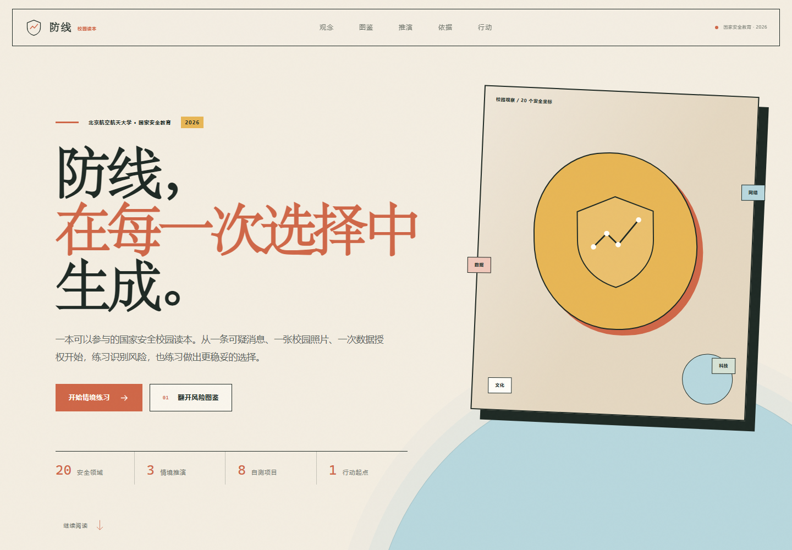
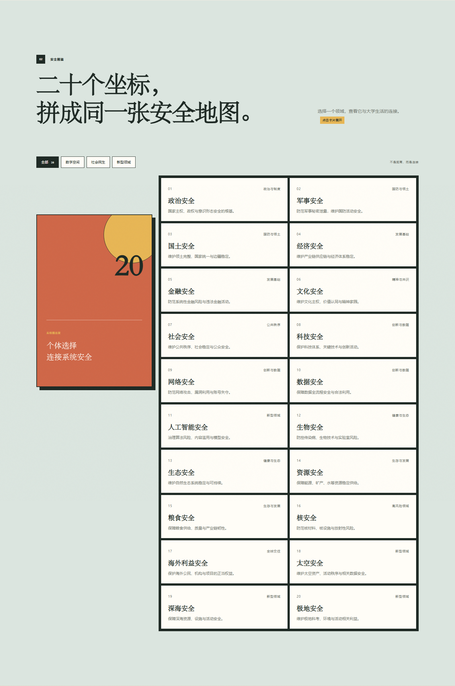
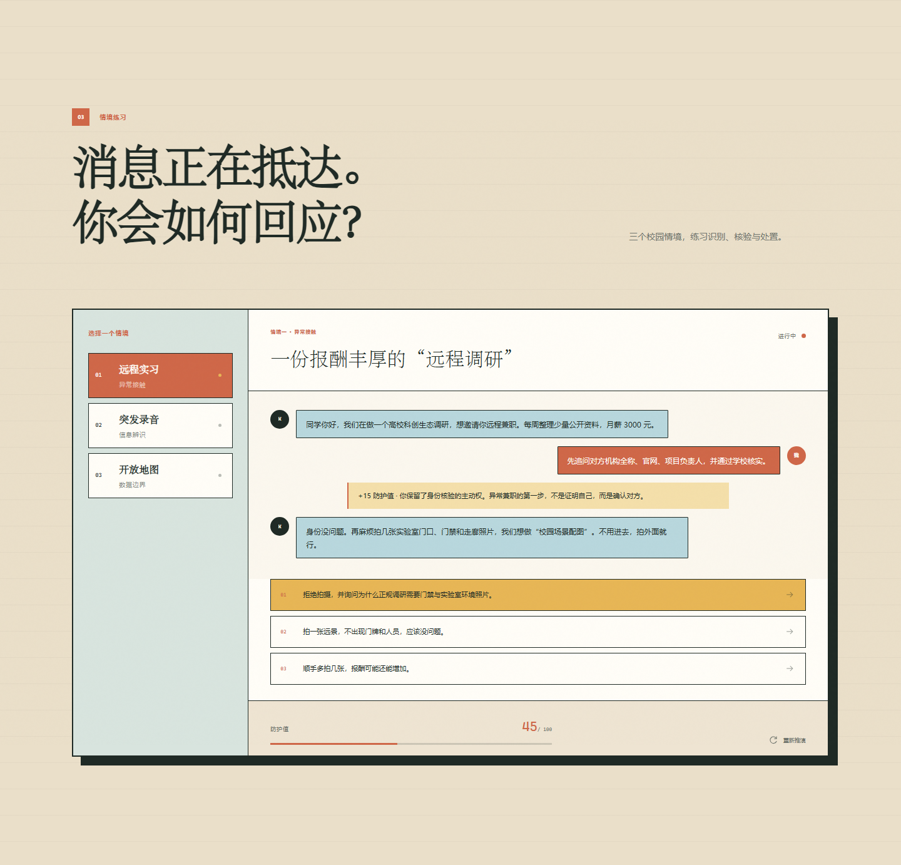
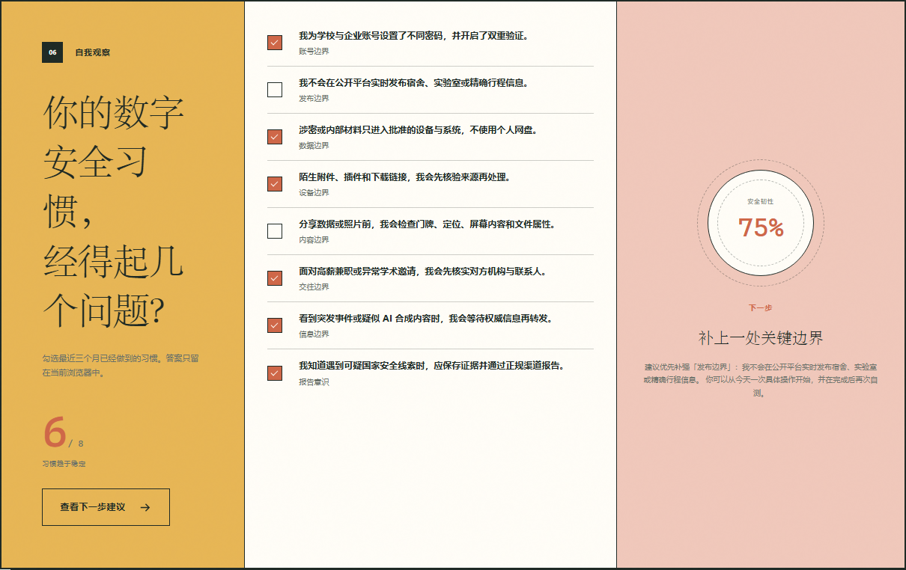
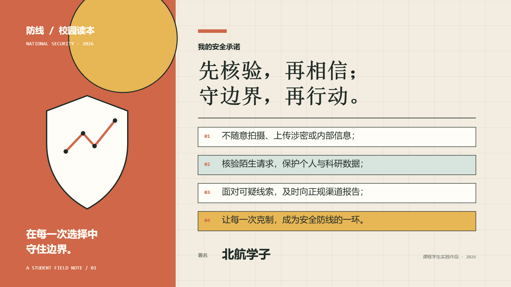

# Defense Line

### An interactive national security reader for university students



[Live website](https://zhuanght-1201.github.io/defense-line/) · [Source](https://github.com/ZhuangHT-1201/defense-line) · [MIT License](LICENSE)

Course: National Security Education, Beihang University, 2026

## Project

Defense Line turns national security education into a sequence of campus decisions: a suspicious message, a synthetic recording, a request for laboratory photos, a dataset headed for a public link.

The website combines a 20-domain knowledge atlas with branching scenarios and a personal safety self-check. Readers can move from understanding a concept to seeing how it changes a real decision.

## Experience

**20 domains, one connected map.** Political, economic, technological, ecological, data, AI and frontier domains are organized into a filterable atlas. Each entry connects the concept to campus life and a practical response.



**Three interactive scenarios.** Readers make choices in real time, watch the safety score change, and receive an explanation of the consequence.



**A reflective self-check.** Eight questions cover accounts, devices, publishing, research data and reporting habits. The result points to one immediately useful next step.



**A shareable pledge.** The final page generates a 1600 x 900 card in the browser, with no account, server or external service.



## Design

The interface borrows from public-education publications and campus exhibitions: warm paper, flat color fields, large Chinese serif type, offset borders and poster-like composition.

The responsive build has been tested at 1440 x 1000 and 390 x 844. Keyboard navigation, dialog focus handling and reduced-motion preferences are supported.

## Run

```bash
npm install
npm start
```

Open `http://127.0.0.1:4173`.

Regenerate screenshots:

```bash
npm run capture
```

Verify the published site:

```bash
npm run verify:live
```

## Structure

```text
.
├── index.html
├── assets/
│   ├── css/styles.css
│   ├── css/editorial.css
│   ├── img/favicon.svg
│   └── js/app.js
├── docs/screenshots/
├── scripts/
│   ├── serve.mjs
│   ├── capture.mjs
│   └── verify-live.mjs
├── LICENSE
└── README.md
```

## Author

Huiteng Zhuang  
Beihang University

MIT License
